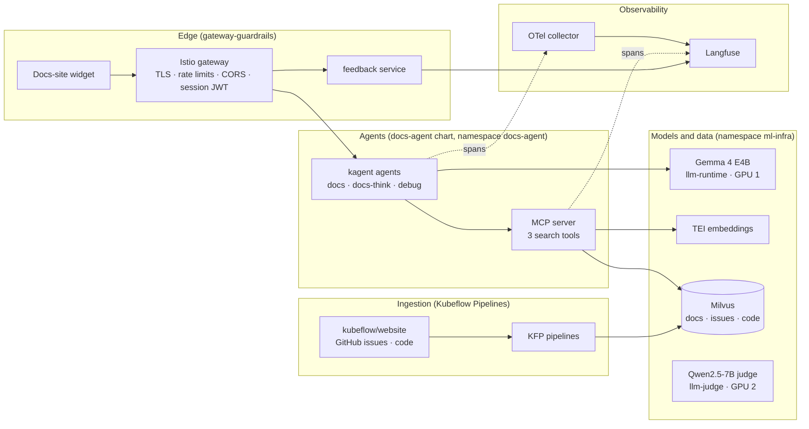

# Architecture

Flo is four loosely coupled layers plus the platform around them. Each layer can
be changed, deployed and evaluated on its own.

## Layers

| Layer | What it does | Code |
|---|---|---|
| Edge | Public entry point. Only the agent stream, session and feedback paths are routed; everything else returns 404. | `docs-agent-mcp/charts/gateway-guardrails/` |
| Agents | kagent `Agent`, `ModelConfig` and `RemoteMCPServer` resources. The agent decides when to search and which tool to use. | `docs-agent-mcp/charts/docs-agent/` |
| Tools | FastMCP server. An intent router picks BM25, hybrid or dense search per query; results carry structured citations. | `docs-agent-mcp/mcp-server/` |
| Models | One model per GPU through KServe and vLLM. The answer model and the judge model are separate releases of the same chart. | `docs-agent-mcp/charts/llm-runtime/` |
| Data | Milvus collections `kubeflow_docs`, `issues_rag`, `code_rag`; 768-d MPNet embeddings from a TEI service. | `docs-agent-mcp/pipelines/` |
| Widget | Chat UI on the docs site: streaming, Sources panel, persona and thinking toggles, answer feedback. | `frontend/` |

## Namespaces

| Namespace | Contents |
|---|---|
| `docs-agent` | Production agents, MCP server, session issuer, feedback service, OTel collector |
| `docs-agent-staging` | The same chart, synced from `main`, plus the eval Job |
| `ml-infra` | Milvus, embeddings, `llm` (Gemma), `llm-judge` (Qwen) |
| `kubeflow` | Kubeflow Pipelines for ingestion |
| `langfuse` | Langfuse (traces, scores, experiments) |
| `argocd` | Argo CD |

## Read next

- [Retrieval (RAG v4)](../RAG_V4_ARCHITECTURE.md): schema, intent router, citation contract.
- [Models and the judge](models.md): why there are two models and how to switch.
- [Gateway and security](gateway.md): what the edge allows and why.
