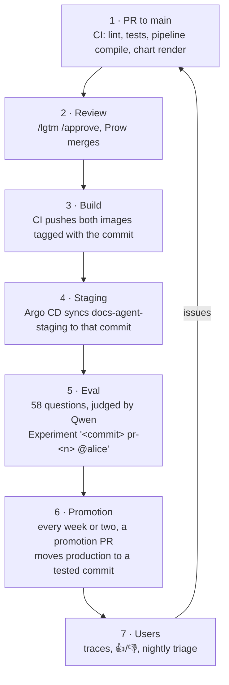

# How a change reaches users

An example: `@alice` improves how the docs agent searches Katib pages.

| Step | What happens | Where to look |
|---|---|---|
| 1. PR | CI checks the code; no cluster access | The PR's checks |
| 2. Review | A reviewer approves; Prow merges | The PR |
| 3. Build | On `main`, CI builds and pushes `ghcr.io/kubeflow/mcp-kubeflow-docs:<short sha>` and `ghcr.io/kubeflow/kubeflow-session-issuer:<short sha>` | Actions run summary |
| 4. Staging | Argo CD syncs `docs-agent-staging` to the new commit and its image | Argo CD, app `docs-agent-staging` |
| 5. Eval | The PostSync Job grades 58 questions; a failed gate fails the sync | Langfuse evaluation project → Experiments, run named `<short sha> …` |
| 6. Promotion | A maintainer runs `deploy/promote.sh`; the PR lists every commit since the last release, yours included, with the eval scores. Merging it deploys production. | The promotion PR, Argo CD app `docs-agent` |
| 7. Users | Answers are traced; feedback is triaged each night | Langfuse live project (maintainers) |

Your change is in production after the first promotion that includes your
commit. Promotions happen every week or two; ask in the PR if a fix needs to go
out sooner.

## What to check on your eval run

- **Routing** stayed at or near 1.0. A drop means the agent stopped calling the
  right tool for some questions; open the failing items to see which.
- **Grounded** did not fall compared with the previous run on `main`. Items rated
  `partial` or `no` have the judge's reason in the score comment.
- **Latency** did not jump.

The judge is a small model, so compare runs rather than reading one score in
isolation.

## Changes that need extra care

- **Models**: a change to `llm-runtime` restarts the GPU pod; it is synced by
  hand, after an eval on the second GPU or with `tests/eval/slm_tool_eval.py`.
- **Gateway**: a change to `gateway-guardrails` affects public routing and
  security. It reaches production with the next promotion, so call it out in
  your PR description for the person promoting.
- **Secrets**: never in a PR. Ask a maintainer.
