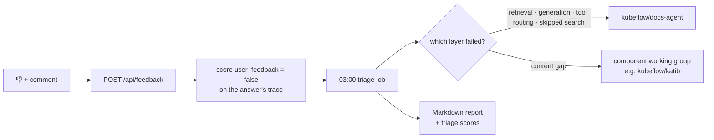

# Feedback and triage

Real users tell us where Flo fails. Every answer in the chat widget has a
**Helpful? 👍 👎** bar; a thumbs-down can carry a comment. Each night a triage job
works out *why* those answers failed and who owns the fix.

!!! info "Status"
    The feedback bar, the feedback service and the triage CronJob arrive with
    [kubeflow/docs-agent#268](https://github.com/kubeflow/docs-agent/pull/268).

What users are told about this data, and how long it is kept, is on
[What we collect](../privacy.md).



## The feedback endpoint

`POST /api/feedback` on the public gateway (session token required, same rate
limits as chat):

```json
{"contextId": "<chat session id>", "turn": 0, "value": "down", "comment": "missing example YAML"}
```

The chat's `contextId` is its Langfuse session. Each user message is one trace in
that session, so `turn` (0-based) picks the answer. The service writes a BOOLEAN
score `user_feedback` with a fixed id, so changing a vote overwrites it. If the
trace has not arrived yet, the vote is stored on the session instead.

Code: `docs-agent-mcp/charts/gateway-guardrails/files/feedback.py` (standard
library only, run from a ConfigMap on a stock Python image).

## Triage

`tests/feedback/triage.py feedback --since-hours 24 --write --report`, run as a
CronJob (`triage.enabled` in the docs-agent chart). For each thumbs-down:

1. Read the question, tool calls, retrieved chunks and answer from the trace.
2. Search the index again independently through the MCP server.
3. Ask the judge whether the retrieved and the re-searched passages contain the
   answer, and whether the answer stayed grounded.
4. Classify:

| Layer | Meaning | Owner |
|---|---|---|
| `ok` | Retrieved the right content and answered from it | – |
| `generation` | Retrieved the right content but answered badly | docs-agent |
| `retrieval` | The index has the answer but the agent's search missed it | docs-agent |
| `tool_routing` | A GitHub issue has the answer but the agent never searched issues | docs-agent |
| `agent_skipped_retrieval` | The agent answered without searching | docs-agent |
| `content_gap_handled` | The docs do not cover it and the agent said so | component working group |
| `content_gap_hallucination` | The docs do not cover it and the agent answered anyway | component working group (and docs-agent for the hallucination) |

Results are stored as `triage_layer` and `triage_component` scores on the trace.
The report in the Job log groups them by owner, with the user's comment. **Nothing
is filed automatically**; a maintainer turns the report into issues.

!!! note "Planned"
    Measuring the judge's agreement with human labels, and letting it choose the
    component from the question and the user's comment. Until then, treat the
    layer and component as suggestions for the person filing the issue.
