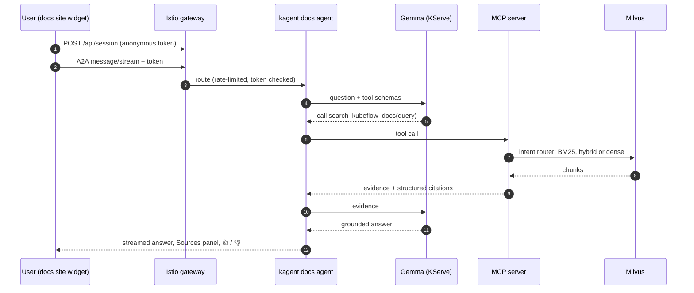

# Flo, the Kubeflow docs assistant

Flo answers questions about Kubeflow from the official documentation, GitHub
issues and source code, and shows the sources it used. It is an agentic RAG
system that runs entirely on Kubernetes: the agent decides which search tool to
call, the tools search a vector database, and a self-hosted model writes the
answer.

The project is `kubeflow/docs-agent`. It started as a Google Summer of Code 2026
project and is becoming a subproject of the Kubeflow Agents working group.

-   :material-sitemap: **Architecture**

    ---

    How a question becomes an answer: agents, MCP tools, hybrid retrieval,
    models, and the public gateway.

    [:octicons-arrow-right-24: Architecture](architecture/index.md)

-   :material-source-pull: **Contributing**

    ---

    How to make a change, how it reaches users, and how to see what it did to
    answer quality.

    [:octicons-arrow-right-24: Contributing](contributing/index.md)

-   :material-chart-line: **Evaluation and feedback**

    ---

    The eval that runs on every merge, and how thumbs-down from real users turn
    into issues.

    [:octicons-arrow-right-24: Evaluation](evaluation/index.md)

-   :material-kubernetes: **Operations**

    ---

    Environments and promotion, Argo CD, tracing and data retention, ingestion.

    [:octicons-arrow-right-24: Operations](operations/index.md)

## At a glance

| Part | What it is |
|---|---|
| Agents | [kagent](https://kagent.dev) `Agent` resources: a docs agent (thinking off and on) and a debug agent |
| Tools | An MCP server with `search_kubeflow_docs`, `search_github_issues`, `search_kubeflow_code` |
| Retrieval | Milvus, hybrid dense + BM25 search chosen per query by an intent router |
| Models | Gemma 4 E4B answers; Qwen2.5-7B judges evaluations. Both served by KServe/vLLM, one GPU each |
| Edge | Istio gateway with TLS, rate limits, CORS allow-list and anonymous session tokens |
| Delivery | Argo CD; staging deploys every commit on `main`, production is promoted to a tested commit every week or two |
| Quality | A 58-question end-to-end eval on every merge; user feedback with nightly triage |
| Privacy | Anonymous sessions; conversations and feedback kept 4 weeks ([what we collect](privacy.md)) |
| Tracing | OpenTelemetry and Langfuse, with live and evaluation traces kept apart |

## The path of one question

