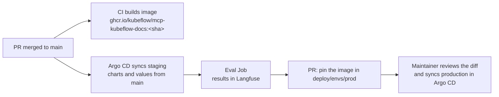

# Environments and delivery

One cluster runs two environments in separate namespaces. Staging always follows
`main`; production moves only when a maintainer syncs it.

| | Production | Staging |
|---|---|---|
| Namespace | `docs-agent` | `docs-agent-staging` |
| Argo CD application | `docs-agent` (manual sync) | `docs-agent-staging` (automatic, self-heal, prune) |
| Values | `deploy/envs/prod/` | `deploy/envs/staging/` |
| Answer model | `llm` (Gemma) | the same `llm` |
| Milvus collections | `kubeflow_docs`, `issues_rag`, `code_rag` | the same collections, read only |
| Public | Yes, through the gateway | No; reached in-cluster through the kagent controller A2A API |
| Langfuse | live project, environment `production` | evaluation project, environment `staging` |
| After each sync | nothing | the [eval Job](../evaluation/eval-on-merge.md) |

Staging shares the model and the vector database with production. Retrieval only
reads, so staging uses the production collections; a change to ingestion that
needs its own collection can point staging at one with `mcp.config.docsCollection`.

## Why namespaces and not branches

A long-lived `staging` and `prod` branch pair drifts and needs merge-backs. With
trunk-based delivery, `main` is what staging runs, and production is pinned in
`deploy/envs/prod/`. A release is a small pull request that changes a pin; a
rollback is reverting it.

## Rolling out a change

| Change | Path |
|---|---|
| MCP server code | Merge → CI builds the image → PR that sets `mcp.image.tag` in `deploy/envs/staging/` and, after the eval, in `deploy/envs/prod/` → sync |
| Charts, prompts, agent settings | Merge → staging syncs and is evaluated → production shows OutOfSync → review the diff → sync |
| Production-only setting (domain, CORS) | PR to `deploy/envs/prod/` → sync |
| Answer or judge model | PR to the `llm-runtime` values → manual sync (GPU restart) |
| Rollback | Revert the PR → sync, or roll back in Argo CD and then revert in Git |
| Hand edit in the cluster | Staging self-heals it away; production shows drift until someone reconciles it in Git |

!!! note "Planned"
    Today the image tag is updated by a pull request. Updating staging
    automatically when CI pushes a new image (Argo CD Image Updater), and a
    "promote to production" workflow, are designed but not merged yet.
