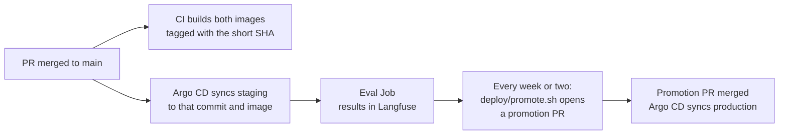

# Environments and delivery

One cluster runs two environments in separate namespaces. Staging runs every
commit on `main`; production runs one commit that was promoted after its staging
eval passed.

| | Production | Staging |
|---|---|---|
| Namespace | `docs-agent` | `docs-agent-staging` |
| Argo CD application | `docs-agent`, `gateway-guardrails` | `docs-agent-staging` |
| Tracks | the commit in `# prod-revision` | `main` |
| Images | `<promoted commit>` short SHA | `<latest commit>` short SHA |
| Sync | automatic, when a promotion PR merges | automatic, on every merge (self-heal, prune) |
| Values | `deploy/envs/prod/` | `deploy/envs/staging/` |
| Answer model | `llm` (Gemma) | the same `llm` |
| Milvus collections | `kubeflow_docs`, `issues_rag`, `code_rag` | the same collections, read only |
| Public | Yes, through the gateway | No; reached in-cluster through the kagent controller A2A API |
| Langfuse | live project, environment `production` | evaluation project, environment `staging` |
| After each sync | nothing | the [eval Job](../evaluation/eval-on-merge.md) |

Staging shares the model and the vector database with production. Retrieval only
reads, so staging uses the production collections; a change to ingestion that
needs its own collection can point staging at one with `mcp.config.docsCollection`.

## Trunk-based delivery

There are no long-lived environment branches. `main` is what staging runs, and
production is a pointer to one commit of `main`. Production therefore gets
exactly what staging tested: code, images, charts and values from the same
commit. A release moves the pointer; a rollback moves it back.

## From merge to production



1. **Build.** Every push to `main` builds and pushes
   `ghcr.io/kubeflow/mcp-kubeflow-docs:<short sha>` and
   `ghcr.io/kubeflow/kubeflow-session-issuer:<short sha>`. CI never touches the
   cluster.
2. **Staging.** The staging Application takes the image tag from the commit it
   syncs (`$ARGOCD_APP_REVISION_SHORT`), so every merge changes staging and
   triggers a sync. If Argo CD sees the commit before CI has pushed its image,
   the sync retries for up to 15 minutes.
3. **Eval.** After the sync, the eval Job grades the deployed stack and records
   the run in Langfuse.
4. **Promote.** Every week or two, a maintainer promotes the newest commit whose
   eval passed:

    ```bash
    deploy/promote.sh            # the tip of main
    deploy/promote.sh 9145c31    # or a specific commit
    deploy/promote.sh --open     # also push to your fork and open the PR
    ```

    The script checks that both images exist, moves every `# prod-revision` line
    in `deploy/argocd/apps/` to the new commit, and writes the PR description:
    the commits since the current production and a table for that commit's
    staging eval scores, so each release keeps its scores in its PR.

5. **Production.** Merging the promotion PR is the deploy: the root Application
   `flo-apps` applies the changed Applications, and `docs-agent` and
   `gateway-guardrails` sync to the new commit.

## Common changes

| Change | Path |
|---|---|
| MCP server code, charts, prompts, agent settings | Merge → staging deploys and evaluates it → included in the next promotion |
| Production-only setting (domain, CORS) | PR to `deploy/envs/prod/` → takes effect with the next promotion |
| Answer or judge model | PR to the `llm-runtime` values → manual sync (GPU restart) |
| Rollback | Revert the promotion PR; Argo CD syncs production back to the previous commit |
| Hand edit in the cluster | Argo CD reverts it (self-heal) on every automatically synced Application |
