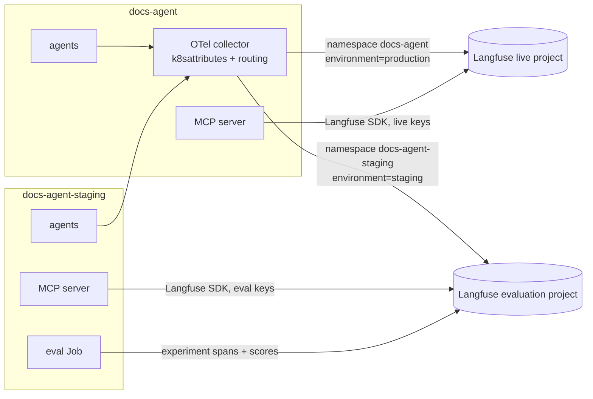

# Observability

Every chat produces a trace in [Langfuse](https://langfuse.com): the agent run,
each model call, each tool call, the retrieval and the query embedding. Traces
from production and staging go to different Langfuse projects, so evaluation
runs never mix with real user conversations.

## Where spans come from

| Source | How | What you see |
|---|---|---|
| kagent agents | OpenTelemetry, endpoint set by the kagent controller | AGENT and GENERATION observations: prompts, tool calls, answers, tokens, latency |
| MCP server | Langfuse SDK (`flo_tracing.py`), off unless keys are set | TOOL, RETRIEVER (hit count, mode, intent, top scores) and EMBEDDING observations |
| Eval Job | OTLP experiment spans and the Scores API | Experiments on the `flo-e2e` dataset with routing and groundedness scores |
| Feedback service | Scores API | `user_feedback` on the answer's trace |
| Triage job | Scores API | `triage_layer`, `triage_component` |

## The collector

The agents' tracing endpoint is set by the shared kagent controller, so agents in
both namespaces send to the same collector. kagent's runtime does not apply
`OTEL_RESOURCE_ATTRIBUTES`, so agents cannot label their own environment.
Instead, the collector's `k8sattributes` processor looks up the namespace of the
pod that sent each span and a routing connector picks the project:

- `docs-agent-staging` → evaluation project, `langfuse.environment=staging`
- everything else → live project, `langfuse.environment=production`

It also drops framework transport spans (`a2a.server.*`, bare HTTP spans) that
would bury the agent, tool and model spans. Config:
`deploy/platform/otel-collector/`.

## Access

| Project | Contents | Who |
|---|---|---|
| Live | Real user questions, feedback, triage | Maintainers and mentors only |
| Evaluation | Eval runs from staging, per commit and PR | Maintainers, plus a shared read-only community account |

The projects are in separate Langfuse organizations, because per-project roles
need Langfuse Enterprise; organization-level Viewer works in the open-source
edition.

## Data retention

Self-hosted Langfuse keeps data forever unless you use its Enterprise retention
feature, so a weekly CronJob (`deploy/platform/langfuse-retention`, Sundays
04:00 UTC) deletes old data per project:

| Project | Kept for | Deleted |
|---|---|---|
| Live | 4 weeks | traces, observations, scores (including `user_feedback`) and raw events, in ClickHouse and in the S3 store |
| Evaluation | 2 weeks | the same; each release's scores stay in its promotion PR |

Datasets, including the eval questions, are never deleted. The windows are in
the job's ConfigMap; setting `DRY_RUN` to `"true"` only prints what would be
deleted.

## Reading a trace

1. Open the project and go to **Traces** (or **Sessions**: the session id is the
   chat's A2A `contextId`).
2. Filter by **Environment**, by session, or by a score such as
   `user_feedback = false`.
3. Open a trace: the tree shows the agent run, then each model call and tool
   call. Retriever observations show which search mode the intent router chose
   and how many hits came back.
